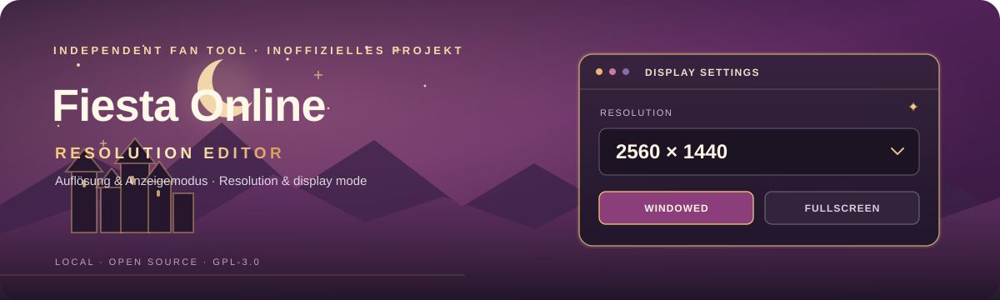

# Fiesta Online Resolution Editor



**A small, local Windows editor for the display settings in Fiesta Online's `Option.mco`.**

[Deutsch](#deutsch) · [English](#english)

## Deutsch

Der Fiesta Online Resolution Editor ändert Auflösung und Anzeigemodus in einer ausgewählten `Option.mco`. Er ist als kleines, quelloffenes Windows-Programm gedacht und benötigt keine Verbindung zu einem Konto oder Online-Dienst.

### Funktionen

- Auflösungen auswählen, die Windows für die angeschlossenen Monitore meldet, oder eine eigene Breite und Höhe eingeben.
- Zwischen **Fenstermodus** und **Vollbildmodus** wählen.
- Vor dem Speichern eine verständliche Vorschau der Änderungen sehen.
- Die Datei direkt auswählen oder einen Spielordner durchsuchen lassen.
- Eine gespeicherte Standardkonfiguration oder eine vorhandene Sicherung wiederherstellen.
- Vor dem Speichern automatisch eine Sicherung der Zieldatei anlegen.
- Schreibschutz gezielt setzen oder entfernen.
- Warnung erhalten, wenn Fiesta läuft oder die Datei seit dem Laden geändert wurde.
- Deutsch oder Englisch nutzen; beim Start wird die Windows-Anzeigesprache berücksichtigt.

### Unterstütztes Dateiformat

Diese Version bearbeitet ausschließlich die geprüfte `Option.mco`-Variante mit **68 Bytes**. Andere Dateigrößen oder unbekannte Werte werden abgewiesen, ohne sie zu verändern. Der Editor verändert nur die von ihm unterstützten Anzeigeeinstellungen in der ausgewählten Datei.

### Starten und verwenden

1. Lade `FiestaResolutionEditor-v1.7.exe` von der GitHub-Seite **Releases** herunter. Beim Erstellen aus dem Quellcode liegt die EXE anschließend im Ordner `release`.
2. Starte den Editor. Administratorrechte sind normalerweise nicht nötig; sie können bei geschützten Installationsordnern erforderlich sein.
3. Wähle `Option.mco` oder lass den Spielordner durchsuchen.
4. Wähle Auflösung und Anzeigemodus. Prüfe die Vorschau und sichere deine Auswahl.
5. Starte Fiesta anschließend neu, damit das Spiel die geänderte Datei einliest.

Die Sicherungen liegen neben der bearbeiteten Datei. Eine selbst gespeicherte Standardkonfiguration befindet sich unter `%LOCALAPPDATA%\FiestaResolutionEditor\Defaults`.

### Datenschutz und Netzwerk

Der Quellcode enthält keine Netzwerk-, Telemetrie-, Update- oder Upload-Funktion. Einstellungen und Sicherungen werden lokal auf dem PC verarbeitet. Für die Liste der verfügbaren Auflösungen fragt das Programm Windows nach den dort gemeldeten Anzeigemodi. Das Programm lädt oder überträgt keine `Option.mco`-Dateien.

### Aus dem Quellcode bauen

Auf Windows mit dem .NET-Framework-C#-Compiler:

```powershell
.\build.ps1
```

Der Build erzeugt `release\FiestaResolutionEditor-v1.7.exe`. Benötigt wird der .NET Framework 4.8 Developer Pack oder Visual Studio Build Tools mit C#-Compiler. Der Editor nutzt Windows Forms und mit Windows gelieferte .NET-Bibliotheken; externe Pakete sind nicht erforderlich.

### Lizenz und Hinweis

Der Quellcode steht unter **GNU General Public License, Version 3 (GPL-3.0-only)**. Lies die vollständige Lizenz in [`LICENSE`](LICENSE). Eine Weitergabe veränderter Versionen muss die GPL-Bedingungen erfüllen und den zugehörigen Quellcode bereitstellen. Das betrifft nicht Fiesta Online oder dessen Spieldateien.

Fiesta Online ist eine Marke ihrer jeweiligen Rechteinhaber. Dieses unabhängige Fan-Projekt wird nicht vom Spielhersteller betrieben oder unterstützt. Spieldateien sind nicht Teil dieses Repositorys.

## English

Fiesta Online Resolution Editor changes the resolution and display mode in a selected `Option.mco`. It is a small, open-source Windows utility designed to work locally without an account or online service.

### Features

- Choose display modes Windows reports for connected monitors, or enter a custom width and height.
- Select **Windowed** or **Fullscreen** mode.
- Review a plain-language preview before saving.
- Select `Option.mco` directly or search a game folder.
- Restore a saved default configuration or an existing backup.
- Automatically back up the target file before saving.
- Set or clear the file's read-only attribute.
- Warn when Fiesta is running or the file changed after it was loaded.
- Use German or English; the Windows display language is detected at startup.

### Supported file format

This version edits only the verified **68-byte** `Option.mco` variant. Other file sizes and unknown values are rejected without modification. The editor changes only the display settings it supports in the selected file.

### Getting started

1. Download `FiestaResolutionEditor-v1.7.exe` from the GitHub **Releases** page. When built from source, the executable is placed in the `release` folder.
2. Start the editor. Administrator rights are normally not required, though a protected installation folder may require them.
3. Select `Option.mco` or choose a game folder to search.
4. Choose a resolution and display mode. Review the preview, then save.
5. Restart Fiesta so the game reads the updated file.

Backups are stored beside the edited file. A saved default configuration is kept under `%LOCALAPPDATA%\FiestaResolutionEditor\Defaults`.

### Privacy and networking

The source code contains no network, telemetry, updater, or upload functionality. Settings and backups are handled locally. To list available resolutions, the program asks Windows for the display modes it reports. The program does not upload or transmit `Option.mco` files.

### Build from source

On Windows with the .NET Framework C# compiler, run:

```powershell
.\build.ps1
```

The build creates `release\FiestaResolutionEditor-v1.7.exe`. The .NET Framework 4.8 Developer Pack or Visual Studio Build Tools with the C# compiler is required. The editor uses Windows Forms and .NET libraries included with Windows; no external packages are needed.

### License and disclaimer

The source code is available under the **GNU General Public License, version 3 (GPL-3.0-only)**. See the full text in [`LICENSE`](LICENSE). Distribution of modified versions must follow the GPL and include the corresponding source code. This does not apply the GPL to Fiesta Online or its game files.

Fiesta Online is a trademark of its respective rights holders. This independent fan project is not operated, endorsed, or supported by the game publisher. No game files are included in this repository.
